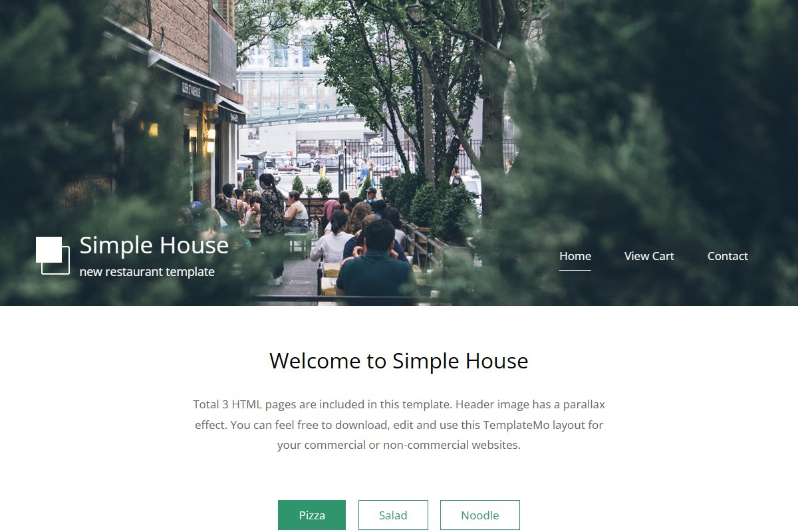

# BookStore: a book shop site in PHP and MySQL

> **Course** Web Application Development (WAD), ICBT Kandy, batch 58 &nbsp;·&nbsp; **Year** 2023 &nbsp;·&nbsp; **Tech** PHP 8 (PDO), MySQL/MariaDB, the *Simple House* template from TemplateMo &nbsp;·&nbsp; **Status** unfinished

  

A small online book shop. Visitors see the books from the database on a shop front, can press **Add To Cart** and open **View Cart**. An admin logs in and adds, edits and deletes books and their front and back covers. The classes (`Book`, `User`, `Config`, `CartItem`) keep the SQL out of the pages. It was built on a free restaurant template, and a good part of that template is still in the pages.

## Which file starts what

| You want | Open | Notes |
|---|---|---|
| **The shop (customers)** | `http://localhost/BookStore/` | Apache serves `index.php` first, so this is the start page. It lists every row of the `book` table |
| **The admin** | `http://localhost/BookStore/Login.php` | on success it goes to `ManageBook.php`, where books are added, edited and deleted |
| The cart | `cart.php` | linked from the shop's menu |

The other files are not entry points: `index.html` is the **original, unused template page** (its links go to `about.html` and `contact.html`, which do not exist); `Home.php` is a stub that only says "HOME PAGE"; `Register.php` is an empty form; `top.php` is the admin menu that `ManageBook.php` includes; `Book.php`, `User.php`, `Config.php`, `cartItem.php` and `LoadBook.php` are classes and helpers.

## Run it

1. Copy the folder into `htdocs` (XAMPP/WAMP) and start Apache and MySQL.
2. In phpMyAdmin run `bookstore.sql`. It creates the database `bookstore` with the tables `book` and `user` and a few made-up books. (The connection in `Config.php` is `root` with no password.)
3. Open `http://localhost/BookStore/`. For the admin side open `http://localhost/BookStore/Login.php` and log in with **`admin` / `admin`**.

`bookstore.sql` is mine: the project came without one, and the `bookstore` database on my PC had only the `book` table (with one row of test text). `Login.php` reads a `user` table that did not exist there, so the admin login could not work as it was. I took the `book` table as it was and wrote the `user` table from the columns the `User` class reads.

## Screenshots

<table>
<tr>
<td align="center" width="50%"> Admin login</td>
<td align="center" width="50%"> Admin: the book form and the list</td>
</tr>
</table>

## Known issues (found by running it; nothing is changed yet)

- **Add To Cart does nothing.** The hidden fields for the book id, title and price are not closed (`<input ... name="hId[]"` has no `>`), the title is posted as `hTitled[]` but read as `hTitle`, and the quantity is read from a field (`hQuantity`) that does not exist. `cart.php` never calls `session_start()` and prints nothing for the items (`<?php $item->Id ?>` has no `echo`, and the total uses an undefined `$i`), so the cart is always empty.
- **The admin page needs no login.** The check in `ManageBook.php` is commented out, so `ManageBook.php` (add, edit, delete) opens for anyone; where a redirect is left, the code after it still runs because there is no `exit`.
- **A cover upload accepts any file.** I uploaded a `.php` file as a front cover on a scratch copy: it was saved into `BookCovers/` and ran when opened. The file name also comes from the uploaded name's extension.
- **Update without choosing new covers wipes the old ones.** Changing only a title and pressing *Update Book* saved the cover paths as `./BookCovers/1F.` and `./BookCovers/1B.` (the form always sends the two file fields).
- Titles, descriptions and authors are written into the pages without escaping, so any HTML typed into the form runs in the page (stored XSS).
- Passwords are compared as plain text (`WHERE Username=? and Password=?`) and the login's password box is a normal text box, so the password is visible while typing. A new session id is not created at login.
- The shop front still carries the restaurant template: the title "Simple House / new restaurant template", the Pizza, Salad and Noodle tabs, and 13 fixed template items (salads and noodles) under the 4 books from the database. Links to `contact.html` and `about.html` give 404, and the admin menu points to `AdminHome.php`, `Sales.php` and `Configure.php`, which do not exist.
- There is no way to register a customer, check out, or see sales.
