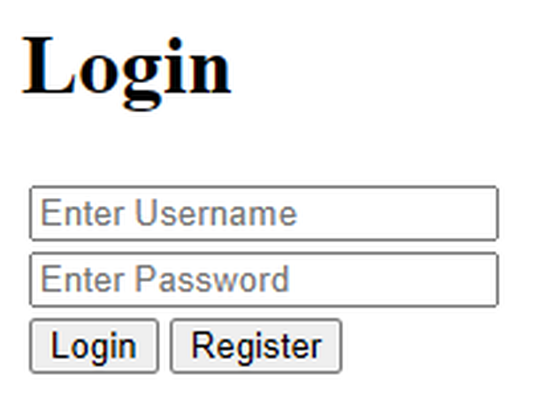
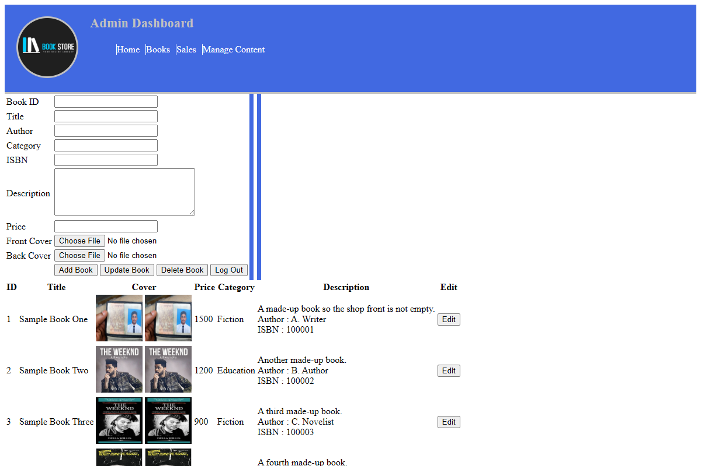
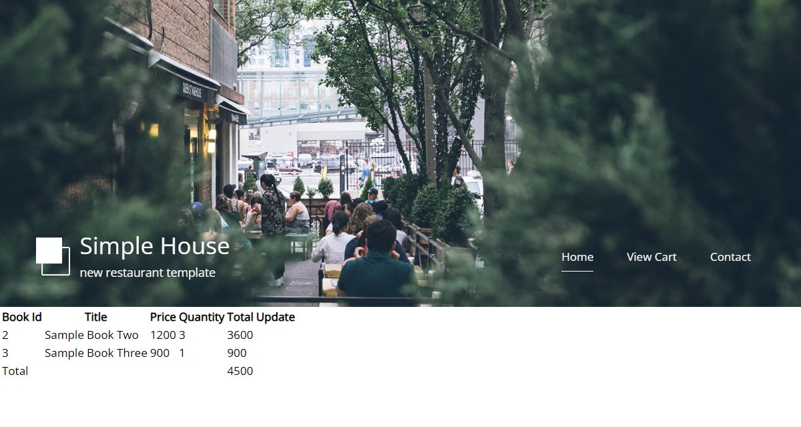

# BookStore: a book shop site in PHP and MySQL

> **Course** Web Application Development (WAD), ICBT Kandy, batch 58 &nbsp;·&nbsp; **Year** 2023 &nbsp;·&nbsp; **Tech** PHP 8 (PDO), MySQL/MariaDB, the *Simple House* template from TemplateMo &nbsp;·&nbsp; **Status** unfinished

  

A small online book shop. Visitors see the books from the database on a shop front, can press **Add To Cart** and open **View Cart**. An admin logs in and adds, edits and deletes books and their front and back covers. The classes (`Book`, `User`, `Config`, `CartItem`) keep the SQL out of the pages. It was built on a free restaurant template, and a good part of that template is still in the pages.

## Which file starts what

| You want | Open | Notes |
|---|---|---|
| **The shop (customers)** | `http://localhost/BookStore/` | Apache serves `index.php` first, so this is the start page. It lists every row of the `book` table |
| **The admin** | `http://localhost/BookStore/Login.php` | on success it goes to `ManageBook.php`, where books are added, edited and deleted |
| The cart | `cart.php` | linked from the shop's menu |

The other files are not entry points: `top.php` is the admin menu that `ManageBook.php` includes; `Book.php`, `User.php`, `Config.php`, `cartItem.php`, `helpers.php` and `LoadBook.php` are classes and helpers. (Two empty pages that nothing used, `Home.php` with just the words "HOME PAGE" and `Register.php` with an empty form, and the unused template page `index.html`, were removed.)

## Run it

1. Copy the folder into `htdocs` (XAMPP/WAMP) and start Apache and MySQL.
2. In phpMyAdmin run `bookstore.sql`. It creates the database `bookstore` with the tables `book` and `user` and a few made-up books. (The connection in `Config.php` is `root` with no password.)
3. Open `http://localhost/BookStore/`. For the admin side open `http://localhost/BookStore/Login.php` and log in with **`admin` / `admin`**.

`bookstore.sql` is mine: the project came without one, and the `bookstore` database on my PC had only the `book` table (with one row of test text). `Login.php` reads a `user` table that did not exist there, so the admin login could not work as it was. I took the `book` table as it was and wrote the `user` table from the columns the `User` class reads.

## Screenshots

<table>
<tr>
<td align="center" width="50%"> Admin login</td>
<td align="center" width="50%"> Admin: the book form and the list</td>
</tr>
</table>

## Fixed in a separate commit

The first commits hold the files as received; the fixes are their own commit. I checked each one in a browser (14 checks):

- **Add To Cart and the cart work.** The hidden fields are closed and named alike, the quantity comes from the quantity box (default 1), the button number `$i` is now counted up (it stayed 0, so every button added the first book), and `cart.php` starts the session (after loading the `CartItem` class), prints the items and adds a total row. Two copies of Sample Book Two plus one more, and one Sample Book Three, give quantities 3 and 1 and a total of 4,500.

  

- **The admin pages need the login.** `ManageBook.php` redirects to `Login.php` (and stops) unless you are logged in; `LoadBook.php` answers 403 without the login.
- **Cover uploads accept only real pictures** (jpg, png, gif, webp, checked with `getimagesize`) and are saved as `BookCovers/<id>F.<ext>` / `<id>B.<ext>`. A `.php` file is refused.
- **Update keeps the old covers** unless a new picture is chosen.
- **Everything written into the pages is escaped** (`h()` in the new `helpers.php`): a title like `<b>Bold</b>` shows as text.
- **Passwords are hashed.** `User.php` fetches the user by name and checks `password_verify`, a new session id is created at login, and the login's password box is a real password box. The demo admin in `bookstore.sql` is stored as a bcrypt hash (`admin` / `admin` still works). If you imported the earlier script, import this one again.
- **`index.html` is removed.** It was the unused original template page; `index.php` is the shop front.

## Known issues (left as they were)

- The shop front still carries the restaurant template: the title "Simple House / new restaurant template", the Pizza, Salad and Noodle tabs, and 13 fixed template items (salads and noodles) under the books from the database. Links to `contact.html` and `about.html` give 404, and the admin menu points to `AdminHome.php`, `Sales.php` and `Configure.php`, which do not exist.
- There is no way to register a customer, check out, or see sales, and the cart cannot be changed once items are in it; the project was never finished.
- Database errors are thrown to the page, and the connection is `root` with no password.
