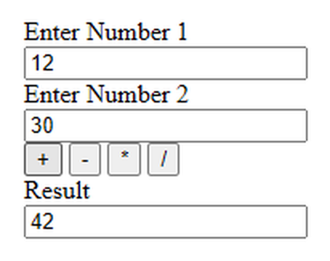
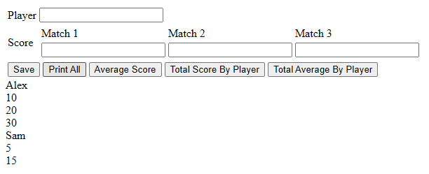

# WAD58 class practicals (PHP)

> **Course** Web Application Development (WAD), ICBT Kandy, batch 58 &nbsp;·&nbsp; **Year** 2023 &nbsp;·&nbsp; **Tech** PHP, no database

Seven small PHP pages from the practical sessions: a login and home page with a session, a calculator, a grade finder, a cookie counter and two array-and-cookie score keepers. Each page is one file with its form and its PHP in the same file.

  
  &nbsp;
  
  &nbsp;
  

| File | What it does |
|---|---|
| `Logging.php` | login form; the e-mail and password are written in the code (below). A good login sets a session and goes to `Home.php` |
| `Home.php` | "Welcome Nuhaadh" and a Logout button; without a session it sends you back to `Logging.php` |
| `Calc.php` | two numbers and the buttons `+ - * /` (the teacher's version is kept as a comment at the top) |
| `Grade.php` | marks for three subjects and a grade for each (A 75+, B 60+, C 50+, S 40+, F below) |
| `CookieDemo.php` | a counter kept in a cookie: **Click Me** adds one, **Reset** sets it to 0 |
| `ArrayDemo.php` | saves player names and three match scores in cookies as JSON arrays; **Print All** lists them |
| `MultiDimensionalArrayDemo.php` | the same screen, keeping the players in one array of objects (unfinished) |

## Run it

Copy the folder into `htdocs` (XAMPP/WAMP), start Apache and open `http://localhost/Practicals/Logging.php` (or any other file by name). No database is needed.

**Login:** `nuhaadh9991@gmail.com` / `nuhaadh` (in `Logging.php`).

I ran every page in a browser on PHP 8.2 (the screenshots; PHP's own warning messages were switched off for them, because they print the folder the page runs from).

## Known issues (found by running them; nothing is changed yet)

- **`Grade.php`: the three marks boxes are all named `txtSub1`**, so only the last value is sent. Marks of 80, 55 and 30 give one grade, F, for the third value, and the other two grades stay empty. PHP 8 also prints "Undefined array key" warnings on the first load.
- **`Calc.php`: dividing by 0 is an uncaught `DivisionByZeroError`**, which prints a fatal error and stops the page. The first load prints "Undefined variable" warnings.
- **`Home.php` still runs after the redirect.** Without a session the browser is sent to the login, but the page itself (including "Welcome") is still produced in the same response, because there is no `exit` after `header()`. The same missing `exit` is in the login redirect.
- Logout redirects to `logging.php` (lower case); the file is `Logging.php`, so it only works on Windows.
- `ArrayDemo.php`: the buttons **Average Score**, **Total Score By Player** and **Total Average By Player** do nothing yet.
- `MultiDimensionalArrayDemo.php`: **Print All** fails with "Attempt to read property 'names' on string" warnings; the page was not finished.
- The Calculator and the Grade finder write what was typed back into the page without escaping it.
- The login's e-mail and password are fixed in the code, and a new session id is not created at login.
