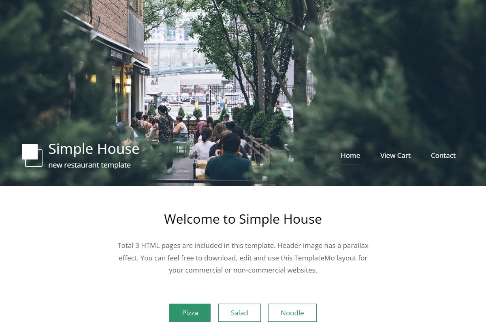
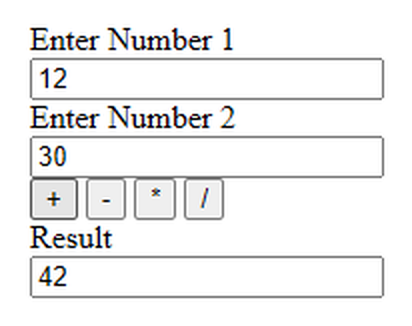

<h1 align="center">WAD58 practicals</h1>

  What I built in the Web Application Development (WAD) module of my 58th batch at ICBT Kandy, in PHP and MySQL. 
  A restaurant system, a book shop and the small class practicals, each in its own folder.

<table>
  <tr>
    <td width="33%" valign="top" align="center">
       
      <b><a href="WAD58RMS">WAD58RMS</a></b> 
      Restaurant management system · PHP · MySQL 
      Customer, staff and admin areas, food and user management. My WAD assignment (unfinished). Bugs found and fixed in a later commit.
    </td>
    <td width="33%" valign="top" align="center">
       
      <b><a href="BookStore">BookStore</a></b> 
      Book shop · PHP · MySQL · template 
      Shop front, cart and an admin page for books and covers. Unfinished; the README says which file starts what.
    </td>
    <td width="33%" valign="top" align="center">
       
      <b><a href="Practicals">Practicals</a></b> 
      Seven class practicals · PHP 
      Login with a session, calculator, grade finder, cookie counter and two array demos.
    </td>
  </tr>
</table>

Each folder has its own README with how to run it, the logins, screenshots and the problems I found. Everything runs on XAMPP (PHP 8, MariaDB); the data in the databases is made up.

## License

MIT, see [LICENSE](LICENSE).
