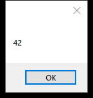
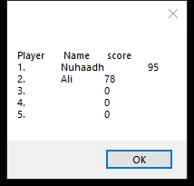
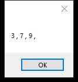
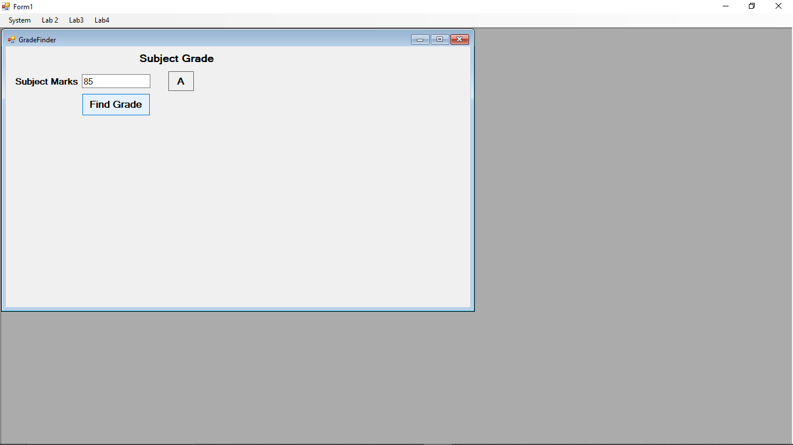

# SOC: C# class projects (HND 58)

The C# work from my Service Oriented Computing (SOC) classes, 2023: Windows Forms exercises and one Web API with a client. They are learning exercises, not production code, kept as they were written.

<table>
<tr>
<td align="center" width="25%"> Methods</td>
<td align="center" width="25%"> Arrays</td>
<td align="center" width="25%"> Lists</td>
<td align="center" width="25%"> Grade finder</td>
</tr>
</table>

| Folder | What it is | Stack |
| --- | --- | --- |
| [`DemoWork5840`](DemoWork5840) | A calculator form and a length (cm) converter | WinForms, .NET Framework 4.8.1 |
| [`ClassWork`](ClassWork) | An MDI app with one window per exercise: methods, arrays, `List<T>`, events, grade finder. Has its own README with screenshots | WinForms, .NET Framework 4.7.2 |
| [`ClassWord58`](ClassWord58) | Lab exercises: grade finder, vowel checker, lists, players and scores | WinForms, .NET Framework 4.7.2 |
| [`ProductSales`](ProductSales) | A two-part assignment: a product REST API (`ProductSales.API`) and a WinForms client for it (`ProductSales.Forms`). Needs a local SQL Server; see its README | ASP.NET Core Web API (.NET 7) and WinForms |

## Running

- The WinForms projects run on Windows only: open the `.sln` of a folder in Visual Studio or Rider and run it.
- `ProductSales` needs a SQL Server database and has to be started in a certain order; see [`ProductSales/README.md`](ProductSales/README.md).
- Each project keeps its own `.sln`; build output (`bin/`, `obj/`) and IDE caches are not stored.

The larger C# workbook I made while learning from a book (about 30 forms, DevExpress screens) is in my private learning repository, not here.
