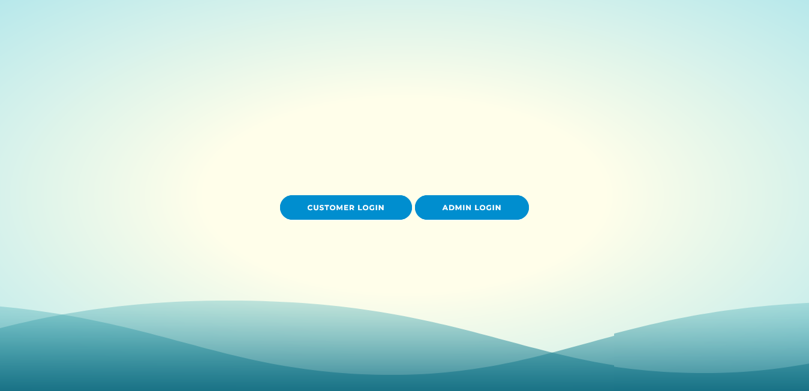
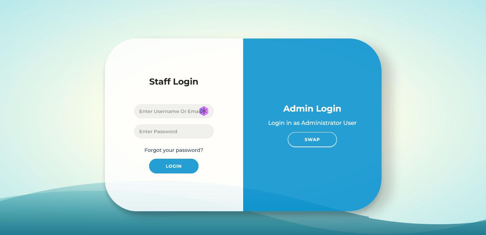

# WAD58RMS

## Overview

WAD58RMS is a web-based application designed to manage and streamline restaurant operations made for my assignment still incomplete.

## Features

-   Add Foods: Allows admins to add food details.
-   User Management: Manage User Details.

## Installation

1. Clone the repository:

    ```bash
    git clone https://github.com/NuhaadhHasn/WAD58.Practical.git
    ```
    (the restaurant system is in the `WAD58RMS` folder of that repository)

2. Copy the `WAD58RMS` folder to your Wampp/Xampp htdocs folder.

3. In phpMyAdmin create a database called `rms` and import `rms.sql`. The connection (`config/config.php`) is `root` with no password.

4. Start the local server and navigate the the URL.

    ```bash
    localhost/WAD58RMS
    ```

## Logins

The database script has three accounts (they are also in `Passwords.txt`):

| Role | Username | Password |
|---|---|---|
| Admin | `nuhaadh` | `nuhaadh` |
| Staff | `staff` | `staff` |
| Customer | `123` | `123` |

Passwords are stored as bcrypt hashes. If you imported an older copy of `rms.sql` (plain-text passwords), import this one again.

## Bug fixes

Found while testing the site and fixed in a separate commit:

-   Visiting an admin page without being logged in redirected to the login page **but still ran the page's code**, so anyone could add or delete food and users with a plain request. Every redirect now stops the script (`exit`), and `editFood.php` and `editUsers.php`, which had no login check, now have one.
-   Uploaded pictures were saved under their original name without any check, so a `.php` file could be uploaded and run. Only real pictures (jpg, jpeg, png, gif, webp) are accepted now, and they are saved under a random name.
-   Names, e-mails and descriptions were written into the pages as they were typed (stored XSS). They are escaped now.
-   Passwords were stored as plain text, and the edit-user form showed the stored one. They are hashed (`password_hash`), the form no longer shows them, and an empty password box keeps the current password.
-   Logging out on the contact page did nothing (no session was started), and its *Login* redirect pointed to a wrong path.
-   Debug `echo` lines on the add-user page and the `img/` 404 for users without a picture were removed.

## Screenshot

### Index Page



### Login Page



### Admin Dashboard Page


### Manage Users Page


## Contributing

1. Fork the repository.
2. Create a new branch:

    ```bash
    git checkout -b feature-branch
    ```

3. Make your changes and commit them:

    ```bash
    git commit -m "Description of changes"
    ```

4. Push to the branch:

    ```bash
    git push origin feature-branch
    ```

5. Create a pull request.

## License

This project is licensed under the MIT License. See the [LICENSE](LICENSE) file for details.

## Contact

For any inquiries or issues, please contact [nuhaadh9991@gmail.com](mailto:nuhaadh9991@gmail.com).
